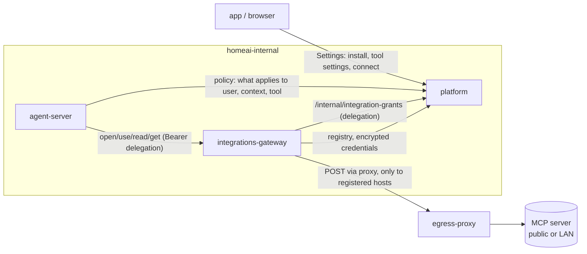

# Integrations (MCP): design

Design for M18 (#259): Model Context Protocol servers as integrations the
agent can use. **Built so far:** the permissions core (#342, M18-02) and
the platform's registry (M18-03, `docs/PLATFORM.md` §4 "Integrations"),
the integrations gateway (M18-04, `docs/ARCHITECTURE.md` §2
"`integrations-gateway`"), its rules at the egress proxy (M18-05,
`docs/ARCHITECTURE.md` §5 "Egress proxy"), token and shared-credential
auth (M18-07 part 1, `docs/PLATFORM.md` §4 "Integrations"), the agent's
integration tools (M18-06, `docs/ARCHITECTURE.md` "Integration tools"), and
Settings → Integrations (M18-08, `docs/ARCHITECTURE.md` "Integration
tools", Frontend). This is the agreed design,
written before any implementation issues; as each part lands, its as-built
description moves into `docs/ARCHITECTURE.md` and this file is trimmed.

It builds on three cross-cutting designs:

- **Permissions** (#342): one model for allowing agent actions.
- **Prompt layout and KV-cache reuse** (#341): the tool list and system
  prompt never change mid-thread; everything new is appended.
- **Undo** (#343): versions and trash, which may later relax defaults for
  HomeAI's own data (it doesn't affect integrations: actions outside HomeAI
  can't be undone by us).

Contents:

1. [Scope](#1-scope)
2. [Concepts](#2-concepts)
3. [Components](#3-components)
4. [Installing an integration](#4-installing-an-integration)
5. [Credentials](#5-credentials)
6. [What the agent sees](#6-what-the-agent-sees)
7. [Permissions and approvals](#7-permissions-and-approvals)
8. [Elicitation (in chat)](#8-elicitation-in-chat)
9. [Errors](#9-errors)
10. [Protocol](#10-protocol)
11. [Audit](#11-audit)
12. [Security notes](#12-security-notes)
13. [Testing](#13-testing)
14. [Later](#14-later)
15. [Implementation breakdown](#15-implementation-breakdown)

---

## 1. Scope

**v1 is about the agent using MCP servers well**, for every user in the
household, with admin control over what's installed and what each tool may
do.

In v1:

- Remote MCP servers, over Streamable HTTP, at any URL the admin enters:
  a public `https://` address or a private LAN address.
- The full current spec (**2026-07-28**) server features the agent needs:
  **tools, resources and prompts**. Elicitation is handled in plain chat
  (§8).
- Installed by admins only; every tool follows the permissions model (#342):
  on or off, then ask or allow.
- Per-user credentials or one shared household credential, chosen by the
  admin per integration. Long-lived tokens/API keys and OAuth.
- Progressive disclosure: the model sees one line per integration and opens
  one when it needs it.
- Available to every user (limiting to specific people is #340).

Not in v1: local (stdio) servers, prompts as user "/" commands, a dedicated
elicitation UI (#344), spec extensions (Tasks, Skills over MCP, MCP Apps),
a curated catalog, tool-definition pinning or change review (the admin
chooses which servers to trust; we take servers as they are), per-argument
policies.

**Design constraint: no shortcuts for our own setup.** HomeAI only knows
the URL an admin pastes. Nothing assumes a server runs on the same machine,
in our compose project or on our Docker network, or that we installed it.
Home Assistant (the first real integration) is treated exactly like any
household's external service.

## 2. Concepts

- **Integration**: one installed MCP server, with a name, URL, auth setup
  and per-tool settings. Installed household-wide by an admin.
- **Availability** (per tool; the admin's for everyone, and each user's for
  themselves): **on** or **off**. A tool is available only if both are on.
  New tools discovered later start off for the admin.
- **Permission** (per tool): the admin's **ceiling** (ask or allow, default
  allow) and each user's own setting (ask or allow, default ask for every
  MCP tool). A call runs without asking only if both say allow.
- **Credential model** (per integration, admin): **each user connects**
  (per-user credential) or **shared** (one household credential). No auth is
  also possible.
- **Connection**: a user's stored credential for a per-user integration, or
  the household's shared one.

## 3. Components



- **platform** owns the registry (integrations, discovered tools, admin and
  user tool settings), the permissions policy (#342), and stores
  credentials as ciphertext. It never decrypts them.
- **integrations-gateway** (new service) is the only component that holds
  the credential encryption key and the only one that calls MCP servers. It
  runs the MCP client (official Python SDK, §10), enforces approvals with
  one-time markers (§7), applies timeouts and size limits, and writes the
  audit log (§11). It sits on `homeai-internal` with no route out; all its
  traffic goes through `egress-proxy`.
- **egress-proxy** keeps its current rules for everyone else (GET/HEAD only,
  no private addresses, ports 80/443 only). The gateway gets its own
  identity at the proxy (a separate listener or proxy credential), and for
  that identity only the proxy allows the methods MCP needs, and only to the
  exact scheme, host and port of registered integrations. The rule list comes
  from the registry.
- **agent-server** gets four fixed tools (§6) that call the gateway with the
  user's delegation, the same pattern as `code-exec-manager`'s exec grants.
- **frontend**: Settings → Integrations. Admins install and configure;
  users connect or disconnect, and see and change their own tool settings.

The agent's own web tools stay read-only. Only the gateway can write to the
outside world, and only to servers an admin installed.

## 4. Installing an integration

Admin flow (Settings → Integrations → Add):

1. **Paste a URL.** The gateway checks it's reachable and speaks MCP
   (§10). Rules for the address:
   - **Public address**: `https://` required.
   - **Private address** (RFC1918, link-local, ULA; loopback is always
     refused): allowed only as an explicit admin decision. The screen shows
     the exact host and port that will be opened through the proxy, with a
     warning. The exception is scoped to that host **and port**, never the
     whole host, because the host may be this machine (allowing
     `192.168.0.108` alone would let the gateway reach HomeAI's own
     services).
   - **A server on the HomeAI machine itself** (e.g. Home Assistant in a
     container next to HomeAI) also needs a host firewall rule. Traffic
     from HomeAI's containers to another device on the LAN is forwarded and
     needs nothing, but traffic to this machine's own address goes through
     its input chain, which ufw denies by default, so the check times out.
     Allow just HomeAI's Docker network to that one port:

     ```bash
     sudo ufw allow from "$(docker network inspect homeai_homeai-net -f '{{(index .IPAM.Config 0).Subnet}}')" \
       to <host> port <port> proto tcp comment 'HomeAI to <host>:<port>'
     ```

     When the check comes back unreachable or timed out for a private
     address, the Add screen shows this command with the real host and
     port. It says so definitely when the address is one of
     `HOMEAI_LAN_ADDRESSES` (this machine's own LAN addresses, optional;
     update it if the machine's address changes), and as an "if" otherwise.
   - **Plain `http://`**: only for private addresses, with a warning that
     credentials cross the LAN unencrypted.
   - **Self-signed certificates**: accepted by pinning the certificate's
     fingerprint at install, after the admin confirms it. A changed
     certificate fails with a clear error until an admin re-confirms.
   - **Names**: an IP address or a normal DNS name. `.local` (mDNS) names
     usually don't resolve inside containers; the screen says so and asks
     for an IP or DNS name instead.
2. **Auth detection.** The gateway learns what the server expects: none, a
   header/token, or OAuth (from the server's protected-resource metadata).
3. **Credential model.** The admin picks **each user connects** or
   **shared** (§5). For shared, the admin enters it now.
4. **Discovery.** Many servers list nothing until signed in, so the admin
   connects their own account (per-user) or uses the shared credential. The
   gateway lists tools, resources and prompts and stores them in the
   registry.
5. **Tool settings.** The admin picks which tools are on and sets each
   one's ceiling (ask or allow; default allow). The server's annotations
   (`readOnlyHint`, `destructiveHint`) are shown next to each tool as
   information only: the spec says to treat them as untrusted, so they never
   change a default. Every user's own setting starts at ask.
6. **Description.** The one-line description the model sees starts from
   the server's own and can be edited by the admin.

Rediscovery runs on demand (admin "Refresh") and when the server reports a
changed list. New tools start off. Uninstalling deletes the integration,
its admin and user tool settings and every stored credential.

## 5. Credentials

**Two models, chosen per integration by the admin:**

- **Each user connects**: every user signs in or pastes their own
  token/key. The integration shows "Connect your account" to users who
  haven't. Calls carry that user's credential, so the server's own per-user
  permissions apply (e.g. each household member's Home Assistant user).
- **Shared**: one household credential entered by the admin. Every user can
  use the integration without connecting. Calls still record which user made
  them (§11).

**Auth methods:**

- **Token / API key** (a header the server expects, e.g. Home Assistant's
  long-lived access tokens as `Authorization: Bearer …`; the admin can name
  another header, such as `X-Api-Key`). Works on every setup. The primary
  method for Home Assistant in v1. A pasted token is tried against the
  server before it's stored: one the server refuses is turned away on the
  spot; one that couldn't be checked (server down) is kept with a note.
  Connecting to a plain `http://` server shows a warning first.
- **OAuth 2.1** as MCP specifies, with PKCE. The gateway handles discovery,
  client registration (Client ID Metadata Documents, dynamic registration,
  or a client ID/secret the admin registered with the provider), the code
  exchange, refresh and revocation. The phone or browser only ever sees the
  sign-in page and passes the code back; tokens never leave the gateway.
  - **Return address.** The provider never contacts the return address;
    the user's browser visits it. So a public domain isn't needed for
    reachability, only when a provider insists on one. Options, in order:
    `homeai://` through the Android app (opened with `expo-web-browser`); a
    page on the server's own address (required by providers like Home
    Assistant, whose client ID URL must share the return address's host,
    and which must be able to fetch that client ID URL); and, for strict
    providers, a static forwarding page on a domain the household owns.
  - Needs a canonical "this server's address" setting, which doesn't exist
    yet (the app knows a list of addresses).
  - Signing in through the app only is acceptable for v1. OAuth is optional
    where the setup allows it; tokens are the fallback that always works.

**Storage:**

- Credentials are encrypted by the gateway (AEAD) with a master key in a
  file only the gateway's container can read, outside the database and the
  backups of the database. The platform stores only ciphertext.
- Each ciphertext is bound to its integration and user (associated data),
  so a row copied to another user or integration fails to decrypt.
- No API returns a credential to anyone, including the user who entered it
  and admins. Admins see connection status only ("connected", "not
  connected", "needs reconnecting") and can disconnect anyone; users can
  disconnect themselves.
- Disconnecting, uninstalling, deleting a user, or a user losing access
  (#340, later) deletes the credential.
- The agent and `code-exec-manager` sandboxes can't reach the gateway's key
  or the credentials. The model never sees them.

**Trust boundary:** this protects against other users, admins using the
app, the agent, the sandbox, and a leaked database dump. It does not protect
against root on the host: the gateway must decrypt credentials to use them,
including for routines that run while nobody is signed in. Root on the host
is trusted. Encrypting with each user's password was considered and
rejected: integrations would stop working whenever that user isn't signed
in, which breaks routines, and a password reset would lose every
credential.

## 6. What the agent sees

The layout follows #341: the static system prompt is the same for every
user and turn; the tool list and per-user context are frozen when a thread
starts; everything else is appended. The tool list differs between users
only when someone has turned a built-in tool off (#342); integrations never
change it.

**Integrations list** (per user, frozen at thread start, after the static
system prompt): one line per integration this user can use now (connected,
shared, or no auth), with its admin-edited description and the names of the
tools on for this user (at most 40, shown past any `group__` prefix:
`HassListAddItem`, not `todo__HassListAddItem`; `open_integration` gives the
exact names). A line above the list says requests about an integration's
devices, lists or data go to the integration rather than HomeAI's own apps
or files. Integrations the user hasn't connected are listed as "not
connected" so the agent can point the user to Settings.

**Four fixed tools**, in the deployment-wide tool list (working names):

| Tool | Does |
| --- | --- |
| `open_integration(name)` | Returns the server's instructions, the tools available to this user (name, description, input schema), resources (URI, name, description) and prompts (name, description, arguments). Tools that are off, for the admin or this user, are not listed. |
| `use_integration(integration, tool, arguments)` | Calls a tool. The gateway validates `arguments` against the tool's schema first and returns a precise error if they don't match. |
| `read_integration_resource(integration, uri)` | Reads a resource. |
| `get_integration_prompt(integration, name, arguments)` | Returns a prompt's messages as text for the agent to follow. |

Everything an integration offers arrives as tool results appended to the
conversation, so opening an integration never changes the cached start of
the prompt. Tools are not bound as native tools mid-thread: on Ornith,
whose chat template renders tool definitions before the system prompt, that
would reprocess the whole conversation each time (#341 measured a full miss
of the ~8k-token start at 33 s). If a heavily used integration ever needs
native tools, the option is an admin setting that adds its tools to the fixed
tool list for everyone (#341, option c).

**Measured** (#341 experiment 4, `scripts/eval/integrations/`, Ornith 1.5
35B, Home Assistant's real tool definitions):

- The request right after opening an integration processes 1,985 of ~11k
  prompt tokens with the fixed tools (~10 s), against all of them with native
  binding mid-chat (~50 s).
- Calls through the fixed tools are as accurate as native ones: lights,
  floors, questions, the TV, an out-of-range value and two-part requests all
  passed in every run, with almost no `invalid_arguments`. Native turns take
  fewer model calls, since there is no opening step.
- The one gap was routing. "Add milk to my shopping list" went to HomeAI's
  own apps (offering to create a grocery-list app) in all but 1 of 13 runs
  with only names and descriptions in the list. Native binding passed every
  time, because `HassListAddItem` is a visible tool. Tool names in the list
  plus the routing line closed it: 16 of 16 with short names, against 4 of 8
  with full `group__name` names. A HomeAI task (saving a note in personal
  files) never touched Home Assistant in any style. As shipped, the fixed
  tools passed all 27 runs (9 cases, 3 each).

So the fixed tools stay, and integrations are not bound natively.

**Results are untrusted content**, like web pages: the system prompt tells
the model never to follow instructions found in integration results or
resources beyond using the integration as the user asked. Prompts fetched
with `get_integration_prompt` are the server's own guidance on using that
server, and get the same caution.

**Size**: results over a cap are trimmed with a note (head and tail kept),
the same as other large tool results.

## 7. Permissions and approvals

Integrations follow the permissions model (#342) exactly; each MCP tool is
a tool like any built-in one:

- **Availability:** a tool is available only if the admin and the user both
  have it on. Unavailable tools aren't listed by `open_integration`, and
  calls to them are refused.
- **Permission:** a call runs without a card only if the admin's ceiling
  and the user's own setting are both allow. Defaults: ceiling allow, user
  ask. Annotations never change this.
- **Routines** follow the same rules: a run stops at a tool that asks and
  waits in its run chat.
- `open_integration`, `read_integration_resource` and
  `get_integration_prompt` are reads (built-in, default allow).
  `use_integration` takes the setting of the MCP tool it calls.
- The admin is trusted: there's no hard-coded always-ask list.

Admin and user settings are stored separately. An admin tightening a tool
later doesn't change users' settings; the admin's wins when a call is
evaluated, and the user's screen shows the effective setting, locked and
labelled.

**Approval cards** show the integration, tool and arguments in readable
form, with approve, reject and "Always allow this" (sets the user's own
setting; hidden when the ceiling is ask). A routine's run chat also offers
"Always allow the tools this run asked for".

**Enforcement is in the gateway**, not only in agent-server: a call that
needs approval runs only with a one-time approval marker bound to the
user, thread, integration, tool and the exact arguments, minted by the
platform after the user approves (generalizing today's migration markers,
`services/platform/app/core/hitl.py`). A prompt injection that talks the
model into skipping the approval card still can't get the call executed.

Policy is per tool, not per argument. For Home Assistant, which devices the
AI may touch is controlled in Home Assistant's own exposed-entities
settings; the docs and the admin screen say so.

## 8. Elicitation (in chat)

In spec 2026-07-28 a server asks the user for input by ending a call with
an `InputRequiredResult` (form mode: a flat schema of fields; URL mode: a
link for sensitive flows), and the client retries the call with the
answer. v1 handles this in plain chat:

1. The gateway returns a standard **needs input** tool result: the server's
   message, the fields it wants (form) or the URL and its host (URL), and a
   short handle. The server's `requestState` stays in the gateway behind the
   handle.
2. The agent asks the user in the chat and ends its turn.
3. When the user replies, the agent calls `use_integration` again with the
   handle and the answers, or with decline or cancel. For URL mode, the
   agent shows the link with its host; the user says when they're done.
4. **The agent can't answer for the user:** the gateway accepts answers to
   a handle only after a new user message in that thread (a later turn than
   the one that received the request).
5. **Routines:** the run ends with the question in its run chat; the user
   can answer there later (run chats are ordinary chats).
6. Handles expire (e.g. after a day); an expired handle returns a standard
   error and the agent starts the call again. A handle is spent only when
   the answer goes to the server: a malformed answer (`invalid_arguments`)
   leaves it usable, so the agent can correct it without asking again.

Sensitive data stays in URL mode only, as the spec requires (form mode must
not ask for secrets). For servers on the older spec (2025-11-25 and
earlier), where elicitation arrives in the middle of a call, the gateway
doesn't declare the capability. A dedicated UI (form cards, consent cards,
waiting runs with notifications) is #344.

## 9. Errors

Every failure reaches the agent as a tool result it can act on, never a
failed turn. The gateway uses a standard set, each with a short code and a
plain sentence telling the model what to do:

| Code | Meaning / what the agent should do |
| --- | --- |
| `not_connected` | This user hasn't connected; tell them to connect in Settings → Integrations. |
| `auth_expired` | Credential rejected or refresh failed; the user (or admin, if shared) must reconnect. |
| `not_found` | No such integration, tool, resource or prompt (or the tool is off). |
| `invalid_arguments` | Arguments don't match the schema; details included; fix and retry. |
| `refused_by_policy` | The tool was turned off during the thread, or the approval was rejected; don't retry. |
| `approval_required` | The tool asks first and the call came without a valid approval marker (§7); don't retry without the user's approval. |
| `needs_input` | Elicitation (§8). |
| `unreachable` | Network error, DNS failure, connection refused, or the proxy blocked it. |
| `timeout` | The server didn't answer in time; may retry once. |
| `too_large` | Result trimmed (with a note) or refused if it can't be trimmed. |
| `server_error` | The server returned an error (its message included, marked untrusted). |
| `protocol_error` | The server doesn't speak a supported MCP version, or broke the protocol. |
| `certificate_changed` | A pinned certificate changed; an admin must re-confirm. |

The server's own tool errors (`isError: true` results) pass through as
results, marked as the server's.

## 10. Protocol

- **Spec**: implement the current spec, **2026-07-28** (stateless requests,
  per-request version in `_meta` and the `MCP-Protocol-Version` header,
  `server/discover`). No hand-written backward compatibility.
- **Library**: the official MCP Python SDK client, 2.x (2.3.0 at the time
  of writing). Its client falls back to the older initialize handshake for
  servers on 2025-11-25 and earlier. This matters for the first integration:
  Home Assistant's MCP server is on the SDK's `mcp==1.28.1`, which speaks only
  up to 2025-11-25.
- **Server features**: tools, resources, prompts, and list-changed
  notifications where the transport delivers them (else refresh on demand).
- **Client features**: elicitation, form and URL mode, per §8, declared only
  to servers on 2026-07-28.
- **Utilities**: progress (logged), cancellation (a stopped turn cancels its
  calls), ping.
- **Transport**: Streamable HTTP only.
- **Extensions**: none in v1.

## 11. Audit

Every gateway call is logged: time, user, integration, tool/resource/prompt,
arguments (secrets never logged), the context (chat, routine, app agent),
the approval (who and how: allowed by settings, or approved on a card), and the
result status and error code. Admins see all of it through the audit viewer
(#311); users see their own in Settings.

## 12. Security notes

Additions to the threat model (`docs/ARCHITECTURE.md` §5):

- **The agent can now act outside the house.** Integrations are the first
  way the agent can change the outside world. The guarantees: only servers
  an admin installed; only through the gateway; enforced at the proxy; every
  non-read action follows the permissions model, enforced in the gateway
  with approval markers.
- **Prompt injection with an exit.** Private data, untrusted content (web
  pages, shared files, integration results) and a way to send data out
  (any integration tool's arguments) can now meet in one turn. Mitigations:
  results marked untrusted; every MCP tool asks by default; the audit log.
  Admins choose which servers are worth that risk.
- **The proxy exception is the sharpest edge.** A private-address exception
  is scoped to one host and port and shown to the admin explicitly. The
  DNS-rebinding gap documented for the egress proxy applies to registered
  hostnames too; for private servers, prefer IP addresses.
- **Credentials**: §5, including the host-root trust boundary.
- **Malicious or compromised servers** can return misleading results or
  change tool descriptions. v1 accepts this (the admin decides whom to
  trust); new tools still start off.

## 13. Testing

- **Fake MCP server** we control (a small test service, 2026-07-28 plus an
  older-handshake mode), used by unit tests and the gate: tokens, OAuth with
  a fake provider, shared vs per-user credentials, tools with annotations,
  resources, prompts, elicitation (form, URL, decline, expiry), a slow
  server, an oversized result, a private-address server, a changed
  certificate.
- **Gate (`gate_m18.sh`)**: install the fake server; agent opens it and uses
  a tool; tools off for the admin or the user are invisible; a tool that
  asks stops in a chat and in a routine run; an admin ceiling of ask
  overrides a user's stored allow; "allow" on both runs without a card;
  another user
  without a connection gets `not_connected`; the gateway refuses a call
  without a marker; credentials never appear in any API response or log;
  the proxy refuses the gateway's POST to an unregistered host and refuses
  POST from every other service.
- **Prefix stability** (#341): opening and using an integration keeps each
  model request starting with exactly the previous one.
- **Eval on Ornith**: Home Assistant–style tasks through the fixed tools
  (does it open the integration, fill arguments correctly, recover from
  `invalid_arguments`), compared against native binding (#341 experiment 4).
- **Tier B (manual)**: a real Home Assistant, installed with its own
  instructions outside this repo, controlling real Hue lights; added through
  the admin screen by URL, with each household member's own token.

## 14. Later

- Limit an integration to specific people (#340).
- Elicitation UI (#344).
- Prompts as "/" commands for users.
- A curated catalog of servers.
- Local (stdio) servers in sandboxed containers.
- Spec extensions (Skills over MCP alongside M21's skills, #333; Tasks; MCP
  Apps).
- Tool-definition pinning and change review.
- mDNS (`.local`) names.
- Per-argument policies.
- Apps using integrations (live web data in apps is #320/#321, deliberately
  separate).

## 15. Implementation breakdown

Proposed issues, filed once this design is agreed:

1. **Permissions model (#342) core**: availability and permission storage
   (admin and user), the rule, the per-user frozen tool list, the
   generalized approval marker, Settings lists; removes routine modes and
   `hitl_enabled`. Prerequisite for 5.
2. **Registry**: platform tables for integrations, tools/resources/prompts,
   credential ciphertext (tool settings live in 1's tables); admin and user
   APIs.
3. **Gateway service**: SDK client, encryption, delegation grants,
   timeouts/limits, standard errors, audit log.
4. **Egress**: gateway identity at the proxy; per-integration rules from
   the registry; private-address and port scoping; certificate pinning.
5. **Agent tools**: the four fixed tools, the frozen integrations list,
   approval cards for integration calls, elicitation in chat.
6. **Auth**: token/API key and shared credentials; then OAuth (app
   return address first), plus the canonical server address setting.
7. **Settings UI**: Integrations for admins (install, tools, shared
   credential) and users (connect, tool settings). Phone-first.
8. **Fake MCP server, eval, gate** (`gate_m18.sh`), HOST-CHECKS § M18 with
   the Home Assistant Tier B steps.
